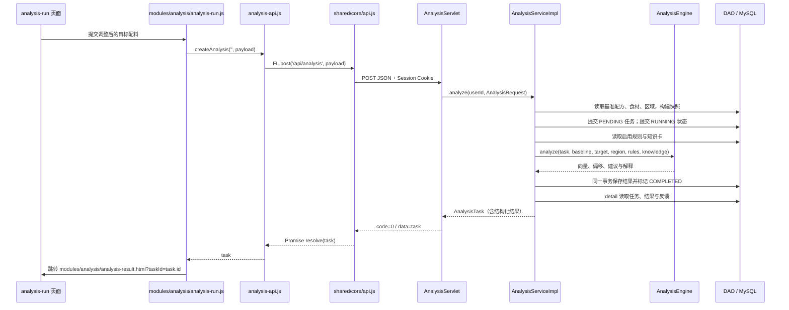

# 答辩流程与源码追踪：从页面到数据库

先打开 [功能源码对照](02-功能源码对照.md) 定位具体操作。再打开运行页面，在浏览器 Network 中确认请求方法、URL、Request Payload 与 Response，再按下列步骤打开源码。所有路径从 `xm-flavor_logic/` 起算；各页、接口、DAO 的可点击查找位置见 [源码索引](02-功能源码对照.md)。运行中的页面来自 Tomcat 部署副本，讲解源码应打开 `frontend/` 与 `backend/src/main/`。

## 1. 保存一份基准配方

| 顺序 | 文件 / 方法 | 可以讲清的内容 |
|---|---|---|
| 页面 | [modules/recipe/recipe-edit.html](../frontend/modules/recipe/recipe-edit.html) | 录入配方名称、工艺、食材和用量；保存按钮触发页面脚本 |
| 页面 JS | [recipe-edit.js](../frontend/modules/recipe/recipe-edit.js) → `saveRecipe()` | 校验表单与配料行，组装 `name / productType / processNote / remark / items`；新建用 `POST /api/recipes`，编辑用 `PUT /api/recipes/{id}` |
| 公共请求 | [api.js](../frontend/shared/core/api.js) → `recipe-api.js → FL.post / FL.put → FL.api` | 拼接部署上下文路径，JSON 序列化请求体，解包 `{code,message,data}` |
| HTTP 入口 | [RecipeServlet](../backend/src/main/java/com/flavorlogic/module/recipe/servlet/RecipeServlet.java) → `doPost / doPut` | 从 Session 取用户编号，把 JSON 绑定为 `Recipe`，调用 `Services.recipe()` |
| 业务 | [RecipeServiceImpl](../backend/src/main/java/com/flavorlogic/module/recipe/service/impl/RecipeServiceImpl.java) → `create / update / normalize / saveItems` | 校验名称、用量、重复食材；编辑校验归属并增加版本；同一事务保存主表与配料明细 |
| SQL | [RecipeDaoImpl](../backend/src/main/java/com/flavorlogic/module/recipe/dao/impl/RecipeDaoImpl.java)、[RecipeItemDaoImpl](../backend/src/main/java/com/flavorlogic/module/recipe/dao/impl/RecipeItemDaoImpl.java) | `recipe` 保存配方信息；`recipe_item.recipe_id` 关联配料；参数来自 Java 对象 |
| 返回 | `RecipeServlet → BaseServlet → JsonUtil → FL.api → saveRecipe` | 返回保存后的配方及编号，页面提示成功并跳转；数据库保存成功后才提示 |

编辑时先更新主表，删除原明细，再插入新明细；`BaseService.write()` 成功提交，任一步失败整体回滚，避免出现只有主表或半份配料的配方。

## 2. 发起一次分析：本项目的主要讲解链路



1. [modules/analysis/analysis-run.html](../frontend/modules/analysis/analysis-run.html) 加载 [analysis-run.js](../frontend/modules/analysis/analysis-run.js)。`submitAnalysis()` 将 `recipeId / goalType / regionProfileId / targetItems / constraints` 组装为 payload；基准配方来自服务端，目标配料来自本页的调整方案。
2. [AnalysisServlet](../backend/src/main/java/com/flavorlogic/module/analysis/servlet/AnalysisServlet.java) 的 `doPost()` 读取 [AnalysisRequest](../backend/src/main/java/com/flavorlogic/module/analysis/model/AnalysisRequest.java)，从 Session 取 `userId`，调用 `Services.analysis().analyze()`。前端不决定数据归属。
3. [AnalysisServiceImpl](../backend/src/main/java/com/flavorlogic/module/analysis/service/impl/AnalysisServiceImpl.java) 的 `analyze()` 调用 `RecipeServiceImpl.detail()` 校验基准归属；`buildSnapshot()` 固化基准食材属性；`buildTargetSnapshot()` 从食材表读取属性并构建目标快照。完全相同的配料方案会被拒绝。
4. 将快照与约束 JSON 写入 `analysis_task`：`recipe_id` 指向基准配方，`baseline_snapshot_json / target_snapshot_json` 保存当时输入，`constraint_json` 保存约束。目标方案不会因为这次分析而写成一份新的 `recipe`。
5. 读取 `flavor_rule / flavor_knowledge` 等数据，调用 [AnalysisEngine](../backend/src/main/java/com/flavorlogic/module/analysis/engine/AnalysisEngine.java)，其中 [FlavorEngine](../backend/src/main/java/com/flavorlogic/module/analysis/engine/FlavorEngine.java) 计算八维向量，[RuleEngine](../backend/src/main/java/com/flavorlogic/module/analysis/engine/RuleEngine.java) 计算偏移并生成建议。Service 还通过 `attachEvidenceReferences()` 给建议补充审核证据关联。
6. [AnalysisResultDaoImpl](../backend/src/main/java/com/flavorlogic/module/analysis/dao/impl/AnalysisResultDaoImpl.java) 写入 `analysis_result`：`task_id` 关联任务，`baseline_json / target_json` 是计算后的向量，`delta_json / suggestion_json` 是偏移和建议；同时保存置信度、完整度、解释与引擎版本。
7. [AnalysisTaskDaoImpl](../backend/src/main/java/com/flavorlogic/module/analysis/dao/impl/AnalysisTaskDaoImpl.java) 标记完成；业务再调用 `detail()` 读回完整结果，经 [BaseServlet](../backend/src/main/java/com/flavorlogic/common/servlet/BaseServlet.java) / [JsonUtil](../backend/src/main/java/com/flavorlogic/common/util/JsonUtil.java) 序列化为统一响应。前端取 `task.id` 跳转结果页。

**事务说明**：这是同步请求中的分阶段状态流程，不是异步任务队列。创建 PENDING、标记 RUNNING 分别提交；“插入分析结果 + 标记 COMPLETED”共享一次事务。计算或结果写入失败后另开事务标记 FAILED，已创建任务会保留，以便解释失败原因。不能说“整个分析过程只有一个事务”。连接与提交/回滚在 [BaseService](../backend/src/main/java/com/flavorlogic/common/service/BaseService.java)，实际 SQL 执行在 [JdbcHelper](../backend/src/main/java/com/flavorlogic/common/persistence/JdbcHelper.java)。

**两个 JSON 概念**：任务中的 snapshot JSON 是配方、用量、当时食材属性；结果中的 baseline/target JSON 是计算得到的八维向量。前者解释输入，后者解释输出。

## 3. 结果回看与试产反馈

| 操作 | 前端 | 接口 / 业务 | 存储 |
|---|---|---|---|
| 回看结果 | [analysis-result.js](../frontend/modules/analysis/analysis-result.js) 请求并渲染图表、偏移、建议和快照 | `GET /api/analysis/{id}` → `AnalysisServlet.doGet` → `AnalysisServiceImpl.detail` | 读取 `analysis_task / analysis_result / analysis_feedback`；JSON 字符串解析为对象；不重新调用引擎 |
| 保存反馈 | 同一脚本提交 helpful、rating、comment、trialResult | `POST /api/analysis/{id}/feedback` → `doPost` → `saveFeedback` | [AnalysisFeedbackDaoImpl.upsert](../backend/src/main/java/com/flavorlogic/module/analysis/dao/impl/AnalysisFeedbackDaoImpl.java) → `analysis_feedback` |
| 查找历史 | [analysis-history.js](../frontend/modules/analysis/analysis-history.js) 提交搜索和分页参数 | `GET /api/analysis/history` → `history` | `AnalysisTaskDaoImpl` 查询任务；点击任务后进入结果详情 |

反馈先校验评分范围和任务归属，再补全 `taskId / userId`。唯一键 `uk_feedback_task_user(task_id,user_id)` 配合 `ON DUPLICATE KEY UPDATE`，同一用户再次提交会更新已有反馈。刷新页面后显示数据库保存的内容。

## 4. 配方生成与知识审核的区别

[recipe-generate.js](../frontend/modules/recipe/recipe-generate.js) 调用 `GET /api/recipes/{id}/compose`，经过 `RecipeServlet → RecipeComposeServiceImpl → GoalTemplateServiceImpl / RecipeComposer` 生成候选配方。这一步只计算；点击保存才发 `POST /api/recipes`，写入 `recipe / recipe_item`。生成候选并不等于已有一条分析历史。

[admin/knowledge/knowledge.html](../frontend/admin/knowledge/knowledge.html) / [pages/admin/knowledge.js](../frontend/admin/knowledge/knowledge.js) 管理来源文档，经 `AdminKnowledgeServlet → SourceDocumentServiceImpl → SourceDocumentDaoImpl` 写入 `source_document`。普通用户 [modules/knowledge/knowledge-search.html](../frontend/modules/knowledge/knowledge-search.html) 通过 `KnowledgeServlet → SourceDocumentServiceImpl → MysqlKnowledgeProvider` 检索已批准文档。来源审核、声明审核、属性版本应用和规则证据关联分别有对应接口；不是导入外部文档后自动改变食材八维属性。

## 5. 数据库现场核对（仅查询）

在 MySQL 客户端替换成刚才保存的编号，逐表展示。以下语句不修改数据。

```sql
USE flavor_logic;
SET @recipe_id = 1; -- 替换为保存响应中的 recipe.id
SET @task_id = 1;   -- 替换为分析响应中的 task.id

SELECT id, user_id, name, version_no, status FROM recipe WHERE id = @recipe_id;
SELECT recipe_id, ingredient_id, ingredient_name, amount, unit
FROM recipe_item WHERE recipe_id = @recipe_id ORDER BY sort_no, id;
SELECT id, recipe_id, user_id, goal_type, status,
       baseline_snapshot_json, target_snapshot_json, constraint_json
FROM analysis_task WHERE id = @task_id;
SELECT task_id, baseline_json, target_json, delta_json, suggestion_json,
       confidence, data_completeness, engine_version
FROM analysis_result WHERE task_id = @task_id;
SELECT task_id, user_id, helpful, rating, `comment`, trial_result
FROM analysis_feedback WHERE task_id = @task_id;
```

可以这样讲：“界面只负责收集输入，页面 JS 发 JSON，请求公共层统一解包响应。Servlet 取登录用户、绑定请求对象；Service 校验权限并控制事务，engine 负责计算，DAO 负责参数化 SQL。数据库保存输入快照与结果，回看读取已保存内容，反馈再次写入并关联原任务。”
